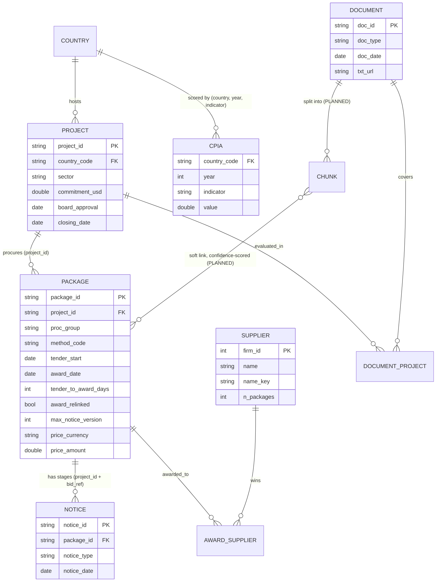

# Data model (Module 1)

Built by `src/procintel/model.py` from the raw ingest tables. Evidence tier: every row count and rate below was
measured on the 120-ICR slice in `data/procintel.duckdb` (2026-10-23). Anything marked **PLANNED** is not built.

## Entity-relationship diagram

## Grains and keys

| Table | Grain | Key | Source |
|---|---|---|---|
| `project` | one World Bank project | `project_id` | projects API |
| `package` | one procurement package = all notices sharing `(project_id, bid_ref)`; a notice with no `bid_ref` is its own package. An award filed under the tender's reference plus "-N" (the bidding round, e.g. "...-CW-RFB-3", "Vandhoo-3rd Tender") is linked to that tender when the suffixed reference has no tender of its own and the tender has no dated award; `award_relinked` marks these (10 packages, median 384 days to award vs 108 overall) | `package_id = project_id/bid_ref` | derived from notices |
| `notice_m` | one published notice | `notice_id` | procnotices API |
| `supplier` | one Bank firm id | `firm_id` | parsed from award text |
| `award_supplier` | package × firm | (`package_id`, `firm_id`) | parsed from award text |
| `document_m` / `document_project` | one document; **many-to-many** to projects | `doc_id` | WDS API |
| `cpia` | country × year × indicator | — | indicators API |

## How the three data types connect

1. **Exact links.** `project_id` joins projects, notices (via package) and documents (via `document_project`).
   One ICR can cover several projects (`"P176278,P179849"`), hence the bridge table.
2. **Soft links (PLANNED).** Linking an ICR passage to a specific package has no shared key. It will use sector,
   procurement group, country and temporal overlap (award date between project approval and closing), stored
   with a `confidence` and a `link_type`, never as a hard fact.
3. **Governance context.** `country_code` joins CPIA scores (6 indicators). Coverage: 52 of 72 project countries.

## Measured properties (120-ICR slice)

- 121 projects, 120 ICRs (2 of them cover 2 projects each), 10,370 notices, 7,002 packages.
- Packages with both a tender notice and an award: 1,169 (80 projects). 137 more have an award dated before the
  tender start and are excluded from `tender_to_award_days` (cause not investigated; likely `bid_ref` reuse).
- Median tender-to-award days: RFQ 33, INDV 83, RFB 106, CQS 136, QCBS 287 (n ≥ 84 each).
- Notice date: `submission_date` equals `noticedate` on all 10,372 cached notices, so it is the publication date.
- Award date parses on 93% of award notices; the rest have empty notice text.

## Known limitations

- **Prices are multi-currency.** Only 1,181 of 7,060 priced awards are in USD; there is no FX table, so amounts are
  stored with their currency and not compared across currencies.
- **Supplier identity.** `firm_id` is the key. 225 normalized names map to more than one firm id (e.g. one firm
  registered twice, and both ids appear together in 28 packages). `name_key` groups them; they are not merged.
  2,093 awards are anonymous individual consultants with no firm id.
- **Linkage is partial.** Only packages whose pre-award and award notices share a `bid_ref` get a tender duration.
- **Slice bias.** The slice is projects that already have an ICR (closed or closing), so it over-represents completed
  projects. Not representative of the 22,729-project portfolio.
- **WGI is not included**: the indicator code tried (`GE.EST`) returned "not found" and the right source was not found.
- Major Contract Awards (`finances.worldbank.org/resource/kdui-wcs3.json`) no longer returns JSON; award notices stand in for it.
