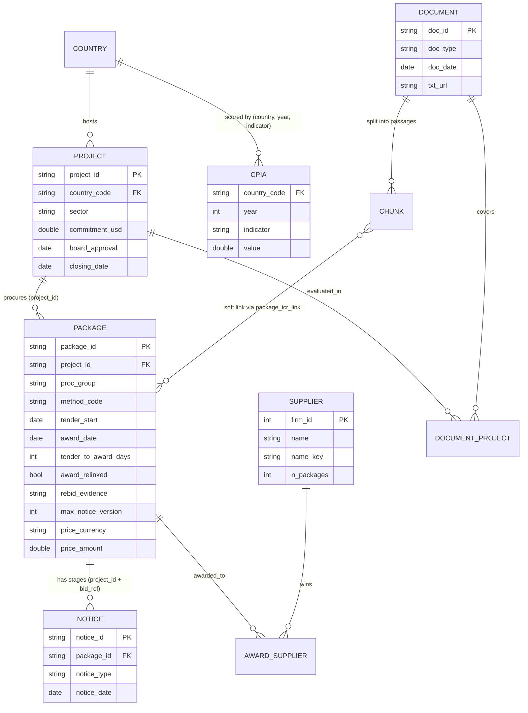

# Data model (Module 1)

Built by `src/procintel/ingestion/tables.py` from the raw ingest tables. Evidence tier: row counts and rates in the
"Measured properties" section were measured on the 120-ICR slice (2026-10-23) and are not refreshed; the current
corpus is larger (151 projects, 22,060 passages, 11,895 notices, 8,175 packages as of 2026-10-27). Every table below is built.

## Entity-relationship diagram

## Grains and keys

| Table | Grain | Key | Source |
|---|---|---|---|
| `project` | one World Bank project | `project_id` | projects API |
| `package` | one procurement package = all notices sharing `(project_id, bid_ref)`; a notice with no `bid_ref` is its own package. An award filed under the tender's reference plus "-N" (the bidding round, e.g. "...-CW-RFB-3", "Vandhoo-3rd Tender") is linked to that tender when the suffixed reference has no tender of its own and the tender has no dated award; `award_relinked` marks these (10 packages, median 384 days to award vs 108 overall). `rebid_evidence` marks an original package that was re-tendered under "-N" (`successor_reference`, 30) or awarded under it (`award_under_suffix`, 10); positive-only evidence from ~12 of 98 projects, so not a re-bid rate | `package_id = project_id/bid_ref` | derived from notices |
| `notice_m` | one published notice | `notice_id` | procnotices API |
| `supplier` | one Bank firm id | `firm_id` | parsed from award text |
| `award_supplier` | package × firm | (`package_id`, `firm_id`) | parsed from award text |
| `supplier_entity` | one Bank firm id | `firm_id` → `entity_id` | firm ids of the same firm merged (`procintel.ingestion.entities`) |
| `firm` | one firm | `entity_id` | most used name, its firm ids, packages won, countries |
| `package_icr_link` | package × ICR | (`package_id`, `doc_id`) | `same_project`, or `same_sector_period`: another project in the same major sector running at the tender date (`procintel.ingestion.sectors`) |
| `document_m` / `document_project` | one document; **many-to-many** to projects | `doc_id` | WDS API |
| `cpia` | country × year × indicator | — | indicators API |
| `wgi` | country × year × indicator | — | indicators API, codes `GOV_WGI_<x>.EST` (`procintel.ingestion.wgi`) |
| `contract_award` | one signed contract | `project_id`, `contract_ref` | Finances One DS00005 (`procintel.ingestion.contract_awards`); matched to `package` on the bid reference; fills `package.award_date` where missing (`award_from_contract`) |

## How the three data types connect

1. **Exact links.** `project_id` joins projects, notices (via package) and documents (via `document_project`).
   One ICR can cover several projects (`"P176278,P179849"`), hence the bridge table.
2. **Soft links.** Linking a report passage to a specific package has no shared key. `package_icr_link` connects a
   package to its own project's report (`same_project`) or to reports of projects in the same major sector running at
   the tender date (`same_sector_period`), with the link type stored, never presented as a hard fact.
3. **Governance context.** `country_code` joins CPIA scores (6 indicators). Coverage: 52 of 72 project countries.

## Measured properties (120-ICR slice)

- 121 projects, 120 ICRs (2 of them cover 2 projects each), 10,370 notices, 7,002 packages.
- Packages with both a tender notice and an award: 1,169 (80 projects). 137 more have an award dated before the
  tender start and are excluded from `tender_to_award_days` (cause not investigated; likely `bid_ref` reuse).
- Median tender-to-award days: RFQ 33, INDV 83, RFB 106, CQS 136, QCBS 287 (n ≥ 84 each).
- Notice date: `submission_date` equals `noticedate` on all 10,372 cached notices, so it is the publication date.
- Award date parses on 93% of award notices; the rest have empty notice text.

## Known limitations

- **Prices are multi-currency.** Only 1,181 of 7,060 priced awards are in USD. Amounts are stored with their currency
  and converted to USD with World Bank yearly rates (table `fx`, `procintel.ingestion.fx`) where a rate exists.
- **Supplier identity.** `firm_id` is the Bank's key, but one firm is often registered under several ids.
  `procintel.ingestion.entities` merges them into `firm` (4,702 ids -> 4,344 firms, 282 merged groups): same name after
  removing case, punctuation and legal-form words, within one country, or across countries for names that are clearly
  organisations; personal names stay apart across countries. All 99 merges with differing spellings were read by hand.
  2,093 awards are anonymous individual consultants with no firm id.
- **Linkage is partial.** Only packages whose pre-award and award notices share a `bid_ref` get a tender duration.
- **Slice bias.** The slice is projects that already have an ICR (closed or closing), so it over-represents completed
  projects. Not representative of the 22,729-project portfolio.
- **WGI** uses the codes `GOV_WGI_<x>.EST`; the older `GE.EST` / `CC.EST` return "not found". 69 of 72 countries covered
  (the 3 missing are regional codes). Shown where CPIA is missing (20 countries, 258 labelled packages); not a model input.
- **Contract awards**: the old Major Contract Awards endpoint (`finances.worldbank.org/resource/kdui-wcs3.json`) returns
  HTML; the Finances One catalog (DS00005, since FY2020) replaces it. 4,341 of 6,990 packages match a contract.

## Text and model layer (built after the first version of this document)

| Table | Grain | Notes |
|---|---|---|
| `chunk` | one passage of a document | `chunk_id = doc_id:seq`, section, text, kind (text or table); completion reports, restructuring papers and ISRs are cut by their own chunkers; passages keep vectors, tags and labels when only their id moves |
| `chunk_vec`, `package_vec` | passage or package description × embedding model | model, dimension and text hash stored, so only new or changed text is embedded |
| `chunk_tag` | passage × tagging model | topic tag, confidence, probabilities (decision model) |
| `chunk_problem` | passage | problem kind extracted by the answer model |
| `project_evidence`, `procurement_check` | project | re-tendering and amendment evidence, procurement ratings from the reports |
| `upload` | one uploaded file | format, status; scanned PDFs are read with OCR |
| `watch`, `alert` | planner × watched scope | in-app alerts only |

Operational data sits in separate DuckDB files (`pipeline`: entity state, event log, rule firings; `jobs`; `auth`:
users, sessions; `feedback`: responses and ratings). In production all of them map to Postgres schemas.
